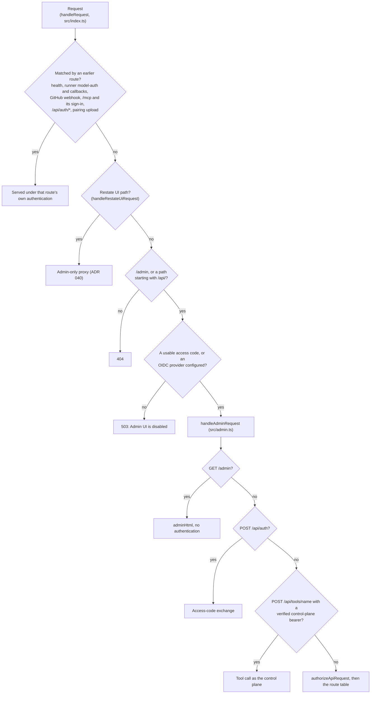

# Admin UI

How the admin single-page app at `/admin` is assembled, served, routed and gated, which page owns which setting, and how to add a page.

This is the reference for `src/admin-ui/`, `src/admin-html.ts`, and the request routing in `src/admin.ts` and `src/index.ts` that serves it. Who may sign in, the `admin` and `user` roles, and page grants as a policy are [access-model.md](access-model.md)'s subject; this document covers only how the SPA and its routes implement them. The escaping rules are [ADR 002](adr/002-admin-ui-html-escaping.md).

The first two sections change with every new page: how to add one, and what each page is and does. The sections after them describe how the whole SPA is put together, which each step of adding a page relies on.

## Adding a page

1. **Write the module.** Create `src/admin-ui/pages/<name>.ts` exporting `<name>Html`, one `<section data-page="<route>" hidden>`, and `<name>Script`, an immediately invoked function expression that ends with `window.registerPage('<route>', init)`. Call the API through `window.api()`, check `res.ok`, and escape with `esc()`, `escAttr()` and `safeUrl()` as ADR 002 requires. Use the shared badge and time helpers rather than a copy of your own. Import only other admin UI modules; text the server owns comes from the page's route. Assign to `window` only what other scripts or inline handlers in the markup call.
2. **Compose it in `src/admin-ui/index.ts`.** Import both strings, add `${<name>Html}` inside `<main>` in `shell`, and add `${pageScript('<route>', <name>Script)}` among the page scripts, after the router element. The `pageScript` name must equal the `data-page` route, or a runtime failure is never reported on the page.
3. **Add the nav item in `src/admin-ui/sidebar.ts`.** Add a `NavItem` with `key: '<route>'`, a `label`, and an `icon` that exists in `iconRegistry` (`icons.ts`; an unknown name renders an empty icon) to one of the four groups. `pages-render.test.ts` then requires a matching `data-page` section in `adminHtml`.
4. **Add the server routes in `handleAdminRequest`** (`src/admin.ts`). They are admin-only by default.
5. **Decide grantability.** To let users open the page, add `'<route>': ['/api/…']` to `PAGE_ROUTES` in `src/access-page-grants.ts`, listing every `GET` path the page reads, exactly and without query strings, and hide any admin-only control on the page with `window.isAdmin()`. To keep it admin-only, leave it out of `PAGE_ROUTES` and give the nav item a `grantBlocker` saying why. `sidebar.test.ts` requires exactly one of the two.
6. **Extend the tests.** Add the script to `MODULES` in `src/admin-ui/__tests__/bundle-syntax.test.ts` (leaving it out fails that file's count check), and add a page test beside the others in `src/admin-ui/__tests__/`, mounting the page with `mountAdminPage` (`src/__tests__/helpers/fixtures/admin-ui.ts`), which runs the real helpers.
7. **Follow the shared table and header rules.** A table row shows the pointer cursor only when it carries `data-job-id`, because those are the only rows that open something; give a row that attribute only if clicking it opens the job drawer. A wide table sits in `.card-body.tight`, which scrolls sideways, so give the table a minimum width rather than letting its text squeeze. The page header wraps its actions below the title on a narrow window.
8. **Update this document**: the page's row in its group's table, its row in the page table, and the settings note if the page holds an orchestrator-wide setting.

## Routes and pages

`sidebar.ts` declares the nav as four groups of `NavItem`s (`key`, `label`, `icon`, an optional `count` badge, and an optional `grantBlocker`). Its exports `SIDEBAR_ROUTES`, `PAGE_LABELS`, `PAGE_GROUPS` and `GRANT_BLOCKERS` are all derived from that one list. The tables below follow it, one per group in sidebar order. The reasons in their last column paraphrase each item's `grantBlocker`, which the grant editor shows verbatim. `no-access` (`pages/no-access.ts`) has a section but no nav item, so it is not a route anyone can select.

### Work

| Route (`#key`) | Label | Module | Grantable to `user` |
|---|---|---|---|
| `overview` | Overview | `pages/overview.ts` | No: carries runner environment values |
| `issues` | Issues | `pages/issues.ts` | Yes |
| `jobs` | Pipelines | `pages/pipelines.ts` | Yes |
| `pulls` | Pull requests | `pages/pulls.ts` | Yes |
| `blockers` | Blockers | `pages/blockers.ts` | Yes |
| `reports` | Reports | `pages/reports.ts` | Yes |
| `kg-pipelines` | Knowledge Graph Pipelines | `pages/kg-pipelines.ts` | No: starts refreshes, changes settings |

### Configure

| Route (`#key`) | Label | Module | Grantable to `user` |
|---|---|---|---|
| `projects` | Projects | `pages/projects.ts` | No: administration, runner environment values |
| `pipelines` | Pipelines & steps | `pages/pipelines-and-steps.ts` | Yes |
| `models` | Models & providers | `pages/models-and-providers.ts` | No: reads the mapping payload |
| `channels` | Triggers & channels | stub (`pages/stubs.ts`) | No: not built yet |
| `policies` | Policies & risk | stub | No: not built yet |

### Platform

| Route (`#key`) | Label | Module | Grantable to `user` |
|---|---|---|---|
| `setup` | Setup | `pages/setup.ts` | Yes: shows every check with its detail and fix; starting a run stays admin-only |
| `runners` | Runners | `pages/runners.ts` | No: global failover control |
| `sessions` | Sessions | `pages/sessions.ts` | Yes |
| `deployments` | Deployments | `pages/deployments.ts` | No: triggers deploys |
| `reaper` | Reaper | `pages/reaper.ts` | Yes |
| `access` | Access | `pages/access.ts` | No: decides who signs in |
| `secrets` | Secrets | stub | No: exposes global secret names |
| `settings` | Settings | `pages/settings.ts` | No: global secrets and infrastructure settings |

### Developer

| Route (`#key`) | Label | Module | Grantable to `user` |
|---|---|---|---|
| `webhooks` | Webhooks | stub | No: not built yet |
| `audit` | Audit log | `pages/audit.ts` | Yes |
| `customizations` | Customizations | `pages/customizations.ts` | Yes |
| `updates` | Updates | stub | No: not built yet |

### What each page shows and changes

| Page | Shows | Changes | Main API calls |
|---|---|---|---|
| Overview | Running jobs, capacity and failure KPIs, teams at their concurrency cap, the last failures in 24 hours, per-project capacity, a line naming the setup check groups that have a failing check (or that no check fails, none has run, a run is going, or the checks cannot be read) with a link to the Setup page, and repos whose `PLANNING.md` or `WORKFLOW.md` still curl Linear directly | Nothing, except **Poll now** | `GET /api/log`, `/api/mappings`, `/api/reaper/summary`, `/api/blockers`, `/api/setup-checks`, `/api/admin/template-status`; `POST /api/poll-now` |
| Issues | The AI-Implement issue inbox across mappings, in-progress counts by team, and a warning naming each ticketing system that did not answer, whose issues and counts are then missing | Nothing | `GET /api/issues` |
| Pipelines (`jobs`) | The dispatch log, with a relative or absolute time filter, planning and implement runs of one issue grouped into one row | For admins only: a row opens the job drawer, **Logs** opens machine or local-runner logs, and an in-flight kg-refresh row has **Stop** | `GET /api/log`; admins also `/api/sessions/<id>/logs`, `/api/jobs/<id>/logs`, `DELETE /api/sessions/<id>` |
| Pull requests | Bot-opened PRs with iteration counts and last dispatch | Nothing | `GET /api/pulls` |
| Blockers | Matched issues that are not dispatching, grouped by reason, with KPIs, and a warning naming each ticketing system that did not answer | Nothing | `GET /api/blockers` |
| Reports | Fleet by repo, one-shot and eventual pass rates, escape rate, planning A/B, runaways, and agent attribution | Nothing | `GET /api/report`, `/api/log` |
| Knowledge Graph Pipelines | The served graph's status and current run, and the runs log | **Refresh graph now**; cancel the current run, or accept a held one where the run offers it; the KG **Backend** (GitHub Actions or Fly machines); the **Materialize** mode (`rdflib` or `direct`); the run profile (Fly CPU kind, CPUs, memory and idle hours, or the GitHub Actions job timeout); the daily refresh schedule | `GET`/`POST /api/kg/execution-mode`, `/api/kg/materialize-mode`; `GET /api/kg/status`, `/api/log`; `POST /api/kg/refresh`; tools `decide_kg_refresh`, `get_kg_status`, `set_run_profile`, `get_pipeline_schedule`, `set_pipeline_schedule` |
| Projects | Every mapping with its runner, session mode, cap, planning, provider and status | Create a project (the stepper, whose **Check installation** reads the App's install state); edit a mapping across the Ticketing, Source, Context, Execution, Capacity, Guardrails, Provider and Agents tabs; pause or resume; delete; **Sync workflows**; per-project secrets | `GET`/`POST /api/mappings`, `PATCH`/`DELETE /api/mappings/<key>`, `/api/mappings/<key>/sync-workflows`, `/sync-status/<id>`, `/secrets`, `/agent-config`, `/api/jira/*`; `GET /api/admin/config-status` (which ticketing systems are configured), `/api/agent-defaults`, `/api/model-accounts`, `/api/admin/github-install-state` |
| Pipelines & steps | Pipeline definitions and step modules, with any `custom/` overrides | Nothing | `GET /api/pipelines-steps` |
| Models & providers | Each project's provider, region, planning and runner | Orchestrator stage defaults per stage (agent, provider, model, fallback model, account profile, elapsed time limit); account profiles (add, set or remove an API key, ChatGPT plan pairing) | `GET /api/model-accounts`, `/api/agent-defaults`, `/api/mappings`; `PUT /api/agent-defaults`; `POST /api/model-accounts`; `PUT`/`DELETE /api/model-accounts/<id>/credential`; `POST …/chatgpt-pairing`; `GET …/chatgpt-status` |
| Setup | The last setup-check run: when it ran and how long it took, counts of failing, warning, cannot-verify and passing rows, then a card per check group and one per project, each listing its failing, cannot-verify and warning rows worst first (title and id, state, what was found, the fix and any fix link) with passing and not-applicable rows folded; while a run goes, its progress; before the first run, an offer to start one; while Restate cannot serve, a notice naming the setup command | For admins only: **Run checks** | `GET /api/setup-checks`; admins also `POST /api/setup-checks/run` |
| Runners | Runner mode and its source, live Fly sessions, capacity, reaper count, per-project execution mode and cap use, and any mappings a forced mode skips | Global runner mode (Project, GHA, Fly, Shadow); Fly process-level secrets; **Unpark** for issues the circuit breaker parked | `GET`/`POST /api/runner-mode`, `GET /api/mappings`, `/api/sessions`, `/api/reaper/summary`, `/api/parked`; `POST /api/parked/unpark` |
| Sessions | Live Fly machines running agent sessions | For admins only: **Destroy** | `GET /api/sessions`; admins also `DELETE /api/sessions/<id>` |
| Deployments | Deploy availability with the running and head commits, the deploy in progress, the last deploy result, deploy status, and held dispatch reservations | The watched source repo and ref, automatic deploy, webhook announcement and whether a deploy applies `fly.toml` (refused with 409 where the control plane owns the machine's configuration); **Deploy now**, **Check now**, and **Cancel** while a deploy drains; Restate and volume-snapshot retention in days; **Release** a held reservation | `GET /api/deployment-status`, `/api/deploy-refs`, `/api/retention`, `/api/dispatch-reservations`; `POST /api/deploy`, `/api/deploy-check`, `/api/deploy-cancel`, `/api/deploy-policy`, `/api/retention`; tool `release_dispatch_reservation` |
| Reaper | The sweep summary and the 20 most recent reaper actions | Nothing | `GET /api/reaper/summary`, `/api/reaper/recent` |
| Access | The sign-in allowlist with bound providers, and recent access changes | Allowlist entries and roles; **Clear bindings**; which pages users may open | `GET`/`POST /api/access`, `POST /api/access/clear-bindings`, `GET`/`POST /api/access-grants` |
| Settings | Current values and where each comes from | Fly sessions app and region; the orchestrator agent-defaults mode (`legacy` or `configured`); the Linear pickup label; the KG refresh failure-report issue and base template repo; extra runner-image prefixes; the retry policy and review max turns; global machine secrets | `GET`/`POST /api/settings`, `GET`/`PUT /api/agent-defaults`, `GET`/`POST /api/global-secrets`, `DELETE /api/global-secrets/<name>` |
| Audit log | Every row of the `dispatched` dedup table, newest first: each issue dispatched and not yet cleared, with no time window | For admins only: **Delete** an entry | `GET /api/dedup`; admins also `DELETE /api/dedup/<id>` |
| Customizations | Files under `custom/` and their upstream counterparts | Nothing | `GET /api/customizations` |

Four things about that table are easy to miss:

- **Orchestrator-wide settings are spread across six pages.** Settings holds the largest group, but the runner mode and Fly process-level secrets are on Runners, the deploy policy and both retention values are on Deployments, the KG backend, materialize mode, run profile and schedule are on Knowledge Graph Pipelines, the per-stage agent defaults are on Models & providers, and the sign-in allowlist and user page grants are on Access. The agent defaults are split in two: Settings switches the mode between `legacy` and `configured`, and Models & providers edits the stage values. Both write through one route, `PUT /api/agent-defaults`, which requires `mode` on every write (400 otherwise), so each page sends the other half back: Settings re-reads the current stages immediately before its `PUT`, and Models & providers sends the mode it last loaded.
- **Some pages act through the tools service rather than an admin route.** They `POST /api/tools/<name>` with a body of `{ "args": { … } }` and get back the tool result, `{ content, isError }`, which the page unwraps itself; a held deploy answers 409 `deploy-in-progress` and an unreachable Restate 503. That route takes its role check from the tool, not from page grants (see "Behind the gate" below).
- **The Restate UI is not part of the SPA.** The Knowledge Graph Pipelines page and the job drawer link to `/ui/…`, which `handleRestateUiRequest` (`src/restate/ui-proxy.ts`) proxies for admins only ([ADR 040](adr/040-admins-reach-the-restate-ui-through-the-orchestrator.md)).
- **A user granted the Setup page sees every check's detail and fix.** `GET /api/setup-checks` answers the stored run whole, the audience [ADR 047](adr/047-orchestrator-setup-checks-only-read-and-what-they-show-depends-on-who-can-reach-an-admin.md) sets for this page. Which surfaces show the checks to whom is [setup-checks.md](setup-checks.md#in-a-running-orchestrator)'s subject.

### The stub routes

Five routes render a "Coming soon" section from `pages/stubs.ts`: `channels` (Triggers & channels), `policies` (Policies & risk), `secrets` (Secrets), `webhooks` (Webhooks) and `updates` (Updates). Each is built by `stubPage()` with a status badge, "Partially implemented" for `channels`, `secrets` and `webhooks` and "Not implemented yet" for `policies` and `updates`; the three partial ones also link to where related functionality lives today. Stubs have no script, so they are exempt from the pageScript alignment test.

## How the page is built

There is no client-side build step. Every module under `src/admin-ui/` exports TypeScript strings (HTML, CSS or JavaScript source), and `src/admin-ui/index.ts` concatenates them into one constant, `adminHtml`, when the module loads. `src/admin-html.ts` only re-exports it. `handleAdminRequest` (`src/admin.ts`) answers `GET /admin` with that constant, setting only a `Content-Type: text/html` header, so the whole UI is one HTML document with every page already in it.

The document has three parts:

- **`head`**: the two CSS strings, `tokensCss` (`tokens.ts`) and `componentsCss` (`components.ts`), inlined in one `<style>` element, plus the Inter and JetBrains Mono fonts from Google Fonts. The root element starts as `data-theme="dark"`.
- **The login panel** (`#login-page`) and **the app shell** (`#admin-page`, hidden until sign-in). The shell holds the sidebar (`sidebarHtml()`) and a `<main>` element containing every page's `<section data-page="…" hidden>` markup, the five stub sections, and the `no-access` section. After the shell comes the markup of three overlays: the job drawer (`drawerHtml`), the filesystem-issue dialog (`filesystemIssueHtml`) and the local-runner-logs dialog (`localJobLogsHtml`). The new-project stepper's markup (`stepperHtml`) is not in `index.ts`; `pages/projects.ts` embeds it inside the Projects section.
- **27 inline `<script>` elements**, in this order:

| # | Element | Source | Wrapped by `pageScript` |
|---|---|---|---|
| 1 | Theme | `themeJs` (`theme.ts`) | No |
| 2 | Shared helpers | `helpersJs` (`helpers.ts`) | No |
| 3 | Auth | `authJs` (`auth.ts`) | No |
| 4 | Router | `routerJs` (`router.ts`) | No |
| 5–23 | One per page, 19 in all: `overview`, `settings`, `projects`, `jobs`, `reaper`, `sessions`, `audit`, `issues`, `pulls`, `blockers`, `customizations`, `pipelines`, `models`, `runners`, `reports`, `kg-pipelines`, `deployments`, `access`, `setup` | `<name>Script` from `pages/` | Yes, under the route key |
| 24–27 | Overlays: `drawer`, `filesystem-issue`, `local-job-logs`, `stepper` | `drawer.ts`, `filesystem-issue.ts`, `local-job-logs.ts`, `stepper.ts` | Yes, under those names |

### Why the scripts stay separate

The split is a containment boundary. `src/admin-ui/__tests__/bundle-syntax.test.ts` is written against the 2026-09-05 lockout (AII-535): in a single `<script>` element, a syntax error anywhere stops everything, login included.

Three kinds of failure are contained, each differently:

- **A syntax error** fails only the element that contains it, because the browser parses each `<script>` element separately. The theme, helpers, auth and router elements come first and are separate, so login and routing still work. The broken page's `registerPage` call never runs, so when the router shows that route it just unhides the section's static markup with no data.
- **A runtime error while a page script runs** is caught by `pageScript()` in `index.ts`, which wraps each page and overlay script in `try { … } catch` and calls `window.markPageFailed(name, err)`. When the router later shows a route recorded in `window.failedPages`, it replaces the section's content with "Page failed to load. Check the browser console for details." This only works when the `pageScript` name equals the section's `data-page` route, which the "pageScript name to data-page route alignment" test enforces.
- **An error thrown by a page's init function** is caught by the wrapper `registerPage` puts around it (`router.ts`), logged, and goes no further.

The first four elements are not wrapped, so an error there is not contained. `bundle-syntax.test.ts` parses every emitted `<script>` element and each module's script string with `node:vm`, so a syntax error fails the unit suite before it ships. It also requires exactly one emitted element per module in its `MODULES` list, each module's source in an element of its own, so merging modules back together, or adding a module without listing it, fails there too.

### Shared helpers

`helpersJs` is its own element ahead of `authJs`, because the sign-in panel `authJs` draws already escapes with it. It defines the rendering helpers every page script uses, all globals on `window`:

| Helper | What it does |
|---|---|
| `esc(s)` | Escapes text for `innerHTML` through a DOM text node. |
| `escAttr(s)` | Escapes `&`, `<`, `>`, `"` and `'` for a quoted attribute value. |
| `safeUrl(s)` | Returns `s` for a relative URL (no colon, or starting with `#`, `/` or `.`) and for `http:`, `https:` or `mailto:`; returns `'#'` for any other scheme, a malformed URL with a colon, or a missing value. |
| `html` and `raw(markup)` | A tagged template that runs `escAttr()` on every interpolation, and `safeUrl()` first when the preceding static chunk ends in `href=` or `src=` (spaces around `=` and an opening quote allowed). `raw()` opts a value out. No page module uses either; the call sites concatenate strings with explicit `esc()` and `escAttr()`. |
| `statusBadge(kind, label)` | A badge with a dot, for a state: a result or condition someone may act on, which can move to another state or clear. `kind` is the stylesheet's badge class (`success`, `warn`, `fail`, `info`, `neutral`, `running`, `outline`); only `running` pulses. |
| `setStatusBadge(el, kind, label)` | The same badge, written into an element already on the page. |
| `labelBadge(kind, label)` | A badge with no dot, for a value that never changes for what it describes, such as a runner kind or a category. |
| `fmtAgo(time)` | Epoch milliseconds or an ISO string as `Ns`, `Nm`, `Nh` or `Nd ago`. |
| `fmtDuration(ms)` | A duration as `Ns`, `Nm Ns` or `Nh Nm`; a negative value reads `0s`. |

Pages move onto the badge and time helpers as each change touches them, so some pages still build badges and format times themselves; `helpers.test.ts` lists the pages already moved.

`authJs` defines the session helpers, also on `window`:

| Helper | What it does |
|---|---|
| `api(path, opts)` | `fetch` wrapper. Sets `Content-Type: application/json`, sends the access-code token from `localStorage` (`admin_token`) as `Authorization: Bearer` when one exists, and always sends cookies (`credentials: 'include'`) so the SSO session cookie rides along. On a **401** it drops the stored token, re-renders the login panel, shows it, and throws `Error('Unauthorized')`. Every other status, including 403 and 503, is returned to the caller, so each call site checks `res.ok` itself. |
| `isAdmin()` | True when the resolved session role is `admin`. Used to withhold admin-only controls inside a page a user can open. Cosmetic: the server refuses those routes anyway. |
| `login()`, `logout()`, `showAdmin()`, `showLogin()` | The access-code sign-in, sign-out, and the swap between the login panel and the shell. |

`routerJs` adds `registerPage(key, init)`, `navigate(route)` (sets `location.hash`), `startRouting()`, `markPageFailed()` and `failedPages`. `themeJs` adds `toggleTheme()`, which flips `data-theme` between `dark` and `light` and stores the choice in `localStorage` under `ai-impl-theme`.

Which escaper goes where, and why `esc()` must never go inside an attribute, is ADR 002's subject.

### How a page module is shaped

A page lives in `src/admin-ui/pages/<name>.ts` and exports two strings:

- **`<name>Html`**: one `<section data-page="<route>" hidden>`, conventionally a `page-header` and a `page-body` of cards.
- **`<name>Script`**: an immediately invoked function expression whose last statement is `window.registerPage('<route>', init)`. Its functions stay private to the closure except those it assigns to `window`, mostly the handlers the markup's inline `onclick`/`onchange` attributes call (`window.saveSessionsApp`, `window.setRunnerMode`, and so on). An inline handler passes at most a row's index; a row built at runtime that needs a value from data attaches its button with `addEventListener` instead, so the value is never serialized into the markup and read back (ADR 002).

The file name and the route key do not always match: `pages/pipelines.ts` is the `jobs` route (labeled "Pipelines"), `pages/pipelines-and-steps.ts` is the `pipelines` route (labeled "Pipelines & steps"), and `pages/models-and-providers.ts` is `models`. The route key is what `data-page`, `registerPage`, `pageScript`, the sidebar and `PAGE_ROUTES` all use.

**A page module imports only other admin UI modules at runtime.** The server composes the admin page while its own modules load, so a page module that imports server code joins the server's import cycle: under Node the orchestrator then throws `Cannot access … before initialization` at boot, while vitest's transform hides it by reading the export as `undefined`. A boundary test in `bundle-syntax.test.ts` fails any non-test module under `src/admin-ui/` whose runtime import resolves outside it (`import type` is free). So a module can embed values from another admin UI module when its string is built, as the Access page does with `JSON.stringify(PAGE_LABELS)`, `PAGE_GROUPS` and `GRANT_BLOCKERS` from `sidebar.ts`, but text the server owns reaches a page through its route: the Setup page reads each check group's display name from `GET /api/setup-checks`, as the sign-in panel reads provider labels from `GET /api/auth/providers`.

Pages can also share code through `window`: `pages/pipelines.ts` defines `window.createDispatchLog(prefix, opts)` and exports `dispatchLogHtml()`, and the Knowledge Graph Pipelines page uses both to render its own "Runs" log filtered to the `kg-refresh` phase.

The overlay scripts are not pages: they never call `registerPage` and have no route. The job drawer exposes `window.openJobDrawer(id)`, the local-logs dialog `window.openLocalJobLogs(id, identifier)`, the stepper `window.openNewProjectStepper()`, and the filesystem-issue dialog opens itself for any same-origin link to `/admin?filesystemIssue=<id>` and, through `window.openFilesystemIssueFromLocation()`, for such a URL loaded directly.

## Startup and routing

1. All 27 script elements run during parsing, before `DOMContentLoaded`, so every page has called `registerPage` before anything is routed. `registerPage` only stores the init function.
2. On `DOMContentLoaded`, `authJs` requests `GET /api/session-identity`. A successful response means the session is live, and the body carries `role` and `grantedPages`.
3. Signed in: `applyNavVisibility` hides every `.nav-item` the session may not open (everything is visible to an admin; a user sees only granted routes) and hides any nav group left empty, then `showAdmin()` reveals the shell and calls `startRouting()`.
4. Not signed in: `renderLogin()` reads `GET /api/auth/providers` to draw the SSO buttons, the deprecated access-code box, and the "nobody can administer" notice, then shows the login panel.
5. `startRouting()` sets the router live, shows the route from `location.hash`, and opens a filesystem issue if the URL names one. Until then every `hashchange` is ignored, because an init runs once and must not render against an unknown role.

`readHash()` accepts a hash only when it names a visible nav item. Otherwise it falls back to `overview` when that is visible, then to the first visible item, then to `no-access`, the section that tells a user with no grants that nothing has been shared yet. So a hidden page cannot be reached by typing its hash either.

`show(route)` toggles each section's `hidden` attribute and each nav item's `active` class, and runs the route's init the first time the route is shown, never again. Nothing is torn down on navigation: a page that starts a poll in its init (Overview, Runners and Deployments every 30 seconds, Knowledge Graph Pipelines every 15 seconds, Issues and Blockers every 60 seconds, among others) keeps polling after you leave it.

The nav is computed once, at sign-in. A grant changed mid-session shows up after a reload; the server enforces the new set on the next request either way ([access-model.md](access-model.md) § "In the SPA").

## Access in the SPA

**A page is grantable exactly when it has an entry in `PAGE_ROUTES`** (`src/access-page-grants.ts`), which maps the route key to the API paths that page may read. The grantable set is `Object.keys(PAGE_ROUTES)`: `GET /api/access-grants` returns it as `grantable`, and `POST /api/access-grants` refuses any key outside it with 400 `not grantable: …`. A page with no entry is admin-only, whatever the sidebar says.

`grantBlocker` in `sidebar.ts` is presentation only. The grant editor on the Access page lists the grantable pages as checkboxes and, under "Some pages can never be granted", every page that carries a `grantBlocker` with its reason. Every nav item has exactly one of the two, a `PAGE_ROUTES` entry or a `grantBlocker`, so the editor lists every page; `sidebar.test.ts` fails a route with neither or with both.

On the server, `authorizeApiRequest` (`src/admin.ts`) lets a non-admin through only for a `GET` whose path, with the query string removed, is listed exactly under one of the granted pages (`grantedRouteAllows`). There is no prefix matching. So a granted page's own reads work, and everything else it might call, apart from the tools route and the review-fix reads described under "Behind the gate", answers 403 `This action requires an admin`. Controls that would make such calls are hidden with `window.isAdmin()`: the Pipelines row click (which opens the job drawer and its logs buttons), the Sessions page's **Destroy**, the Audit log's **Delete**, and the Setup page's **Run checks**.

The roles, the grant table, the reasons a page is ineligible, and the "user-role `/mcp` reads are the floor" caveat are [access-model.md](access-model.md)'s § "Roles" and § "Page grants".

## The API side

### Where the routes are served

`handleRequest` in `startServer` (`src/index.ts`) checks its routes in order and returns at the first match. Several paths are matched before the admin gate, each with its own authentication: the runner-facing model-auth, token and callback routes (`/runner/model-auth/*`, `/api/token`, `/api/runner/*`, `/api/status`, `/api/step-report`), `/api/github/webhook`, the MCP sign-in and `.well-known` routes, the SSO routes under `/api/auth/` (mounted before the gate so they work when `ADMIN_ACCESS_CODE` is unset), and `POST /api/chatgpt-pairing/upload`. The Restate UI proxy comes next. Everything else that is `/admin` or starts with `/api/` reaches the gate, then `handleAdminRequest`.

`handleAdminRequest` holds every admin route in one function, each matched by method and by path (exact, prefix or regular expression); an `/api/` path it does not match answers 404 `Not found`. The order inside it matters only where patterns overlap, and the code says so where it does (the secrets and agent-config routes are checked before the generic `PATCH`/`DELETE /api/mappings/<key>` handlers).

### The gate when no admin auth is configured

When there is no usable access code and no OIDC provider is configured (`isOAuthConfigured()` in `src/oauth/providers.ts` is false), both `/admin` and every `/api/` path that reaches the gate answer **503** with a JSON body, `{"error": "Admin UI is disabled. Configure SSO (OAuth providers + the OAUTH_ALLOWED_* allowlist) or set ADMIN_ACCESS_CODE, then redeploy to enable the Admin UI."}`. Even `GET /admin` gets that JSON rather than the page. The Restate UI paths answer their own 503 under the same condition. `loadConfig` logs `[main] admin UI disabled — set ADMIN_ACCESS_CODE and/or configure OAuth providers` at boot.

A usable access code is `ADMIN_ACCESS_CODE` set to anything but the published `.env.example` placeholder, which `effectiveAccessCode` (`src/admin-session.ts`) treats as unset: the gate counts it as missing, `POST /api/auth` refuses it with 403, and `loadConfig` warns that it is refused.

A provider counts only when it is usable: `resolveProviders` (`src/oauth/providers.ts`) leaves out a provider with none of its variables set, drops one with only some of them set (naming the unset variables), drops BuildDown without an `https://` issuer, and drops Microsoft when its tenant is `common`, `organizations` or `consumers`. `loadConfig` logs each dropped provider as `[main] <id> sign-in disabled: <reason>`. `OAUTH_REDIRECT_BASE_URL` is not part of this gate; without it the SSO start and callback routes answer their own 503.

### Behind the gate

Once the gate passes, the page itself is public: `GET /admin` (any query string) returns `adminHtml` without checking a session, and the data behind it is what is protected. `POST /api/auth` needs no session either: it answers a matching access code with a new session token, which the SPA keeps in `localStorage` and sends as a bearer, and answers 403 when there is no usable access code or the code is wrong. Every other `/api/` route goes through `authorizeApiRequest`:

1. `authenticateAdminRequest` (`src/admin-session.ts`) resolves the session from the httpOnly session cookie first, then an `Authorization: Bearer` header, and re-checks the identity against the allowlist. No session, or an identity no longer admitted, is **401**, which the SPA treats as signed out. An unreadable allowlist is **503**, so a database fault does not sign everyone out. An access-code session has no identity and is treated as `admin`.
2. `GET /api/session-identity` is answered here for every authenticated session, with `email`, `name`, `provider`, `authMethod`, `role` and `grantedPages`, because the SPA needs it to know it is signed in.
3. `POST /api/tools/<name>` goes through to the tools service with the session's own role; the tool's role check, not page grants, decides.
4. `GET` reads of a review-fix attempt and its activity are open to every authenticated identity; the facade enforces scope.
5. Everything else needs `admin`, or a non-admin `GET` that `grantedRouteAllows` matches. Otherwise **403**.

`POST /api/tools/<name>` with a bearer is handled before this list while a control-plane token is active: a bearer that verifies as the BuildDown control plane's token calls the tool as the control plane, and one that does not falls back to the list. No other `/api/` route accepts that token.
