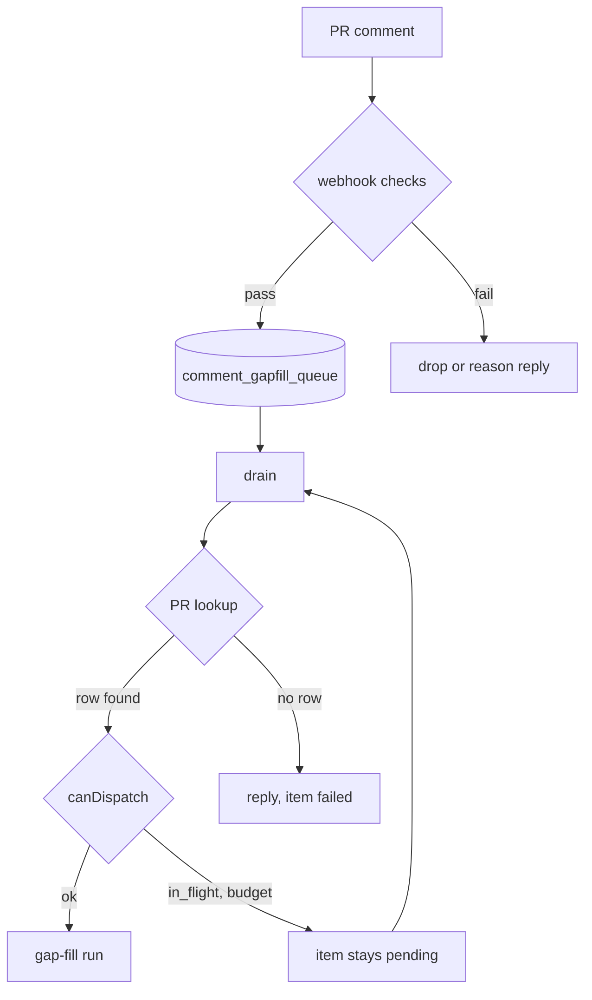

# `/ai-implement` comment rail

A PR comment starting with `/ai-implement [instruction]` asks for a gap-fill run on that PR. Every comment ends in a run, a deferral, or a reply that states the true reason. Start at `src/webhook.ts` (`handleIssueCommentWebhook`) and `src/comment-gapfill-drain.ts`.

## Webhook checks

Applied in order. The queue is only reached when all pass; 👀 is added at enqueue.

| Check | Failure answer (200) | PR reply |
|---|---|---|
| Repo has a mapping | `no_mapping` | none |
| App credentials configured | `no_app_credentials` | none |
| Installation token | `token_error` | none (no token to post with) |
| Contract probe (`resolveWorkflowContract`, `failOnTransient`) | `legacy_repo` for a real legacy workflow | none |
| Contract probe cannot read the workflow (twice) | `contract_probe_failed` | "could not read this repository's workflow … repost" |
| Commenter has write/maintain/admin | `insufficient_permission` (also a 404 from the API: not a collaborator) | none |
| Permission API errors (fetch throw, 5xx, 429, bad JSON; twice) | `permission_check_failed` | "could not check your permission … repost" |
| Comment and PR ids present | `missing_issue_comment_fields` | none |

The probe and the permission check each retry once with no sleep (GitHub's delivery timeout is 10 s). GitHub never retries a delivery itself and the redelivery sweep runs only at Restate registration, so the retry-then-reply path is what keeps a transient error from being silent. If posting the reply fails, it is logged and the webhook still answers 200 with the reason.

`probeCapabilities` (`src/workflow-probe.ts`) does not cache a `legacy` result that came from a fetch throw, a non-404 error status, bad JSON or a non-file body. A 404 and a real legacy workflow are cached for 5 minutes. Without `failOnTransient` the probe never throws.

## Queue

`comment_gapfill_queue` holds one row per comment (`owner`, `repo`, `prNumber`, `commentId`, `commenter`, `instruction`, `status`). `claimPendingCommentGapfills` hands rows to the drain; a row leaves `pending` only through `markCommentGapfillProcessed` (`dispatched`, `failed`, `skipped`).

## Drain and PR lookup

For each claimed item the drain resolves the PR's dispatch row, in this order:

1. `getLatestDispatchForPr`: a row whose `pr_url` is the PR.
2. On a miss, read the PR once (`getPullRequestState`), then:
   1. Roll-up parent: head `ai-implement/<feature|multi-issue>/<key>` resolves to the parent issue's latest dispatch.
   2. In-flight run: the newest `dispatched`/`running` row in the same repo whose issue identifier matches the head branch (`branchMatchesIssueIdentifier`). The PR's own run has the branch identifier but no `pr_url` until it completes. Ended runs already have `pr_url` and are not matched.
3. No match: "no record" reply.

## In-flight deferral

When step 2.2 matches, `canDispatch` refuses with `in_flight`, the item is left `pending` with no reply, and the next drain retries it. Once the run sets `pr_url`, step 1 finds it and the item dispatches. There is no age cap: the job timeout, stuck watchdog and reaper end the run. Other `canDispatch` or admission refusals (`pr_budget`, capacity) defer the same way.

## Drain replies

| Condition | Reply | Item |
|---|---|---|
| PR cannot be read (null or throw) | "could not read this PR from GitHub just now … repost" | `failed` |
| No dispatch row, no roll-up parent, no in-flight match | "AI-Implement has no record of this PR. Please trigger a new implementation run from the issue tracker first." | `failed` |
| PR dispatch budget reached | budget park message (once, on the park transition) | `pending` |
