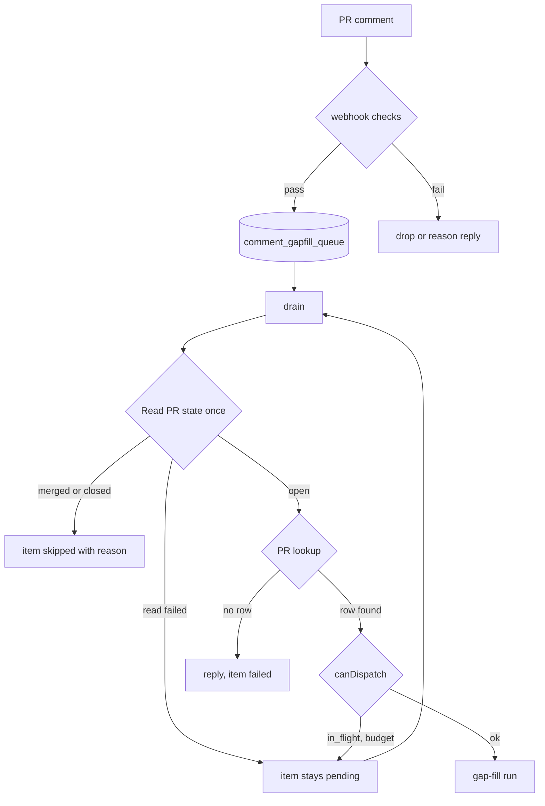

# `/ai-implement` comment rail

A PR comment starting with `/ai-implement [instruction]` asks for a gap-fill run on that PR. Every comment ends in a run, a deferral, or a reply that states the true reason. Start at `src/webhook.ts` (`handleIssueCommentWebhook`) and `src/comment-gapfill-drain.ts`.

## Webhook checks

Applied in order. The queue is only reached when all pass; 👀 is added at enqueue.

| Check | Failure answer (200) | PR reply |
|---|---|---|
| Repo has a mapping | `no_mapping` | none |
| App credentials configured | `no_app_credentials` | none |
| Installation token | `token_error` | none (no token to post with) |
| Contract probe (`resolveWorkflowContract`, `failOnTransient`) | `legacy_repo` for a real legacy workflow | none |
| Contract probe cannot read the workflow (twice) | `contract_probe_failed` | "could not read this repository's workflow … repost" |
| Commenter has write/maintain/admin | `insufficient_permission` (also a 404 from the API: not a collaborator) | none |
| Permission API errors (fetch throw, 5xx, 429, bad JSON; twice) | `permission_check_failed` | "could not check your permission … repost" |
| Comment and PR ids present | `missing_issue_comment_fields` | none |

The probe and the permission check each retry once with no sleep (GitHub's delivery timeout is 10 s). GitHub never retries a delivery itself and the redelivery sweep runs only at Restate registration, so the retry-then-reply path is what keeps a transient error from being silent. If posting the reply fails, it is logged and the webhook still answers 200 with the reason.

`probeCapabilities` (`src/workflow-probe.ts`) does not cache a `legacy` result that came from a fetch throw, a non-404 error status, bad JSON or a non-file body. A 404 and a real legacy workflow are cached for 5 minutes. Without `failOnTransient` the probe never throws.

## Queue

`comment_gapfill_queue` holds one row per comment (`owner`, `repo`, `prNumber`, `commentId`, `commenter`, `instruction`, `status`). `claimPendingCommentGapfills` hands rows to the drain; terminal PR checks and processing updates move rows out of `pending` (`dispatched`, `failed`, `skipped`).

## Drain and PR lookup

For each claimed item with a repository mapping, the drain reads `getPullRequestState` before admission gates. Merged PRs immediately become `skipped` with `last_refusal_reason = pr_merged`; closed, unmerged PRs use `pr_closed`. This emits one terminal log line, consumes no refusal count, and posts no reply or budget notice. Subsequent ticks do not read the skipped row. A null or thrown PR read does not change the flow that existed before this check. An item with a dispatch log goes on to the admission gates. An item with no dispatch log gets the reply "AI-Implement could not read this PR from GitHub just now … repost" and ends `failed`, so the drain does not read it again on each tick. A failure to get the installation token affects every row, so it leaves the row `pending` for the next tick.

For an open PR, the drain resolves its dispatch row in this order:

1. `getLatestDispatchForPr`: a row whose `pr_url` is the PR.
2. On a miss, reuse the same PR read for its head branch, then:
   1. Roll-up parent: head `ai-implement/<feature|multi-issue>/<key>` resolves to the parent issue's latest dispatch.
   2. In-flight run: the newest `dispatched`/`running` row in the same repo whose issue identifier matches the head branch (`branchMatchesIssueIdentifier`). The PR's own run has the branch identifier but no `pr_url` until it completes. Ended runs already have `pr_url` and are not matched.
3. No match: "no record" reply.

## ImplementationRun ownership

After the existing mapping, paused/filesystem, `canDispatch`, budget-notice and ephemeral full-access checks, the drain submits `ImplementationRun` with the queue item ID and PR-scoped gap-fill input. This applies to every project on GitHub Actions, Fly Machines and local Docker, including `CONFLICT_COMMENTER` feature-branch re-queues. Stored review-fix lifecycle is not read; shadow mode selects GitHub Actions only. There is no Legacy fallback.

Restate unavailability or an unavailable submission leaves the item pending and logs `skipped: Restate unavailable`. An unregistered service also leaves it pending. Accepted and conflict submissions mark it dispatched; the workflow reserves capacity and PR occupancy, restoring pending if reservation is refused. Token minting, managed preparation and backend launch happen inside the workflow.

GitHub Actions gap-fill recovery uses the persisted `comment_gapfill_launch` intent’s frozen owner/repo and workflow target. `readStatus` and `stop` also use that original owner/repo even when the current mapping disappears or points to a different repository. Monitoring and crash recovery therefore keep authority over the original launch.

## Open review findings

At workflow launch, the run's instruction is the comment's text followed by the PR's open review findings (`buildCommentGapfillInstruction`, `src/comment-gapfill-drain.ts`, reading `listOpenReviewFindings`). A human's inline review comment is recorded in the ledger and starts no run on its own ([review-fix-rail.md](review-fix-rail.md#a-human-inline-comment-is-recorded-not-enqueued)), and the agent cannot read the PR, so this block is how `/ai-implement` addresses those comments. A bare `/ai-implement` gets the block alone; with no open findings the instruction is the comment text unchanged.

Each finding is rendered whole under its `finding_key`, the same shape a review-fix task uses, so the agent's `fixed` / `invalid` disposition resolves it when the run succeeds and anything undisposed stays open (review-fix-rail.md § "Resolution"). The block holds at most 30 findings and 12,000 characters (`MAX_COMMENT_FINDINGS_BLOCK_CHARS`), because `commentInstruction` has no cap of its own; a finding that does not fit is left out whole, never clipped, and the block says how many were left out. A conflict-resolution row (`CONFLICT_COMMENTER`) gets no block, since review work could fail its review and lose the merge commit; a push-retry row replays a human comment and keeps it.

## In-flight deferral

When step 2.2 matches, `canDispatch` refuses with `in_flight`, the item is left `pending` with no reply, and the next drain retries it. Once the run sets `pr_url`, step 1 finds it and the item dispatches. There is no age cap: the job timeout, stuck watchdog and reaper end the run. Policy refusals (`pr_budget`, parked state, capacity) instead count toward the three-refusal limit described below.

## Drain replies

| Condition | Reply | Item |
|---|---|---|
| PR merged or closed | no reply (one log line) | `skipped`, reason `pr_merged` or `pr_closed` |
| PR token acquisition fails or PR cannot be read (null or throw) | no reply; retry next tick | unchanged |
| No dispatch row, no roll-up parent, no in-flight match; comment from a person | "AI-Implement has no record of this PR. Please trigger a new implementation run from the issue tracker first." | `failed` |
| Same, but the commenter is `ROLLUP_REVIEW_COMMENTER` | no reply (one log line) | `skipped` |
| PR dispatch budget reached | budget park message (once per park, also when the dispatch breaker parked the PR first) | `pending` |

### Roll-up review-only runs

A programmatic queue row whose commenter is `ROLLUP_REVIEW_COMMENTER`
(`ai-implement-rollup-review`) requests an advisory review of the existing PR.
The drain uses the usual PR identity resolution, including recovery from a roll-up
parent. When the drain finds no parent dispatch for a roll-up review row, it skips
the row quietly (one log line, item `skipped`, nothing posted, no retry).
When the runner image is not the paired image (`resolveSessionImage` source is not
`default`; local Docker is exempt), Restate launch preparation skips the review
the same way and launches no run; see the [paired-image rule](workflow-envelope.md#advisory-review-only-gap-fills).

Restate launch preparation sets the envelope's `reviewOnly` payload to
`integration-review` plus the project's effective gating reviewers, deduplicated by
id. An unset project selection uses the normal defaults; an empty selection still
runs `integration-review`. The payload's optional `expectedHeadSha` is recovered
from the queue row's exact generated instruction, including retry rows and rows
queued before this field existed; it is never replaced with the live PR head.
Malformed synthetic instructions fail launch preparation. If the PR head has moved,
the runner reports a skip with both heads before reading the diff or invoking a
reviewer. It posts no verdict, and the callback files no child or retry while still
finalizing the dispatch. Envelopes from older orchestrators that omit the field
continue reviewing the current head. Open ledger findings are not appended as fix instructions.

An incomplete roll-up review with a nonempty list of failed reviewers, all classified
`transient` (for example `PROVIDER_OVERLOADED`), queues one retry for the same head.
`ROLLUP_REVIEW_RETRY_LIMIT = 1` caps retries per repository/PR/head across every queue
state. Non-transient or unclassified failures and a second incomplete result get no
retry. The initial queue key is unchanged; attempt 1 has a distinct hashed negative
ID and retains `ROLLUP_REVIEW_COMMENTER`. The retry uses the normal drain and budget
checks with `humanRequested=false`. The verdict follow-up says “one retry is queued”
or “no retry is left; a person decides”. Partial findings remain advisory.

The runner reviews the full PR diff once and posts one verdict comment marked
`<!-- ai-implement rollup-review -->`, showing the short reviewed head SHA and
explaining that the verdict does not block the merge: blockers are filed as one `[roll-up-review]` child until the two-child
limit is reached. Findings are deduplicated only by `stableReviewFindingKey`,
with all reporting reviewer IDs, severity, file:line and body on each entry.
Reviewer failure produces an incomplete verdict. No implement or fix
pass, repository hook, commit, push, or external-review polling runs. The callback
finishes the dispatch row with `rollup_review` and preserves the findings ledger,
dispositions and approval marks; it does not submit `LateExternalReview`. Findings
are advisory and cannot authorize merging. The owning workflow preserves successful
and failed `rollup_review` results, including when a deadline follows the callback,
and releases the reservation without implementation tracker transitions or stuck
remediation. Each terminal result is given a follow-up notice: it names the filed
child, says
when no child is needed, or names failed reviewers for an incomplete review
(with a fallback when review failed before a reviewer ran). At the two-child
limit, including on incomplete reviews, it says a person must decide further fixes. When the verdict comment update fails, the callback keeps the saved notice pending and answers 503, so the runner's bounded result-delivery retries post it without filing another child (see `docs/feature-branch-grouping.md` § 6).
Ordinary comment gap-fills are unchanged.

## Failed rounds

A Restate-owned gap-fill reporting `outcome: "failure"` posts its existing run autopsy
on the job's PR, as well as the unchanged ticket delivery. The autopsy says the PR
is unchanged for an unapproved round and includes final reviewer feedback, or run
notes when review did not run. An `INSTALL_FAILED` callback also carries a shared
autopsy with the installation diagnostics; it explains that the approved change
was not built or tested and that the existing PR was updated. The PR comment adds guidance to post a new `/ai-implement` comment with a
changed instruction. Unapproved changes remain discarded; no diff is published.

Callback lifecycle effects are serialized per dispatch before checking the persisted
completion guard, suppressing repeat PR and ticket posts for overlapping deliveries
and retries after report forwarding fails. Report forwarding
still runs on those retries. A GitHub failure (or missing autopsy/target/credentials)
is a callback warning and does not prevent the failed row write or report delivery.
The monitor's separate failure classification names the phase as “Gap-fill failed”.

Before submitting an ImplementationRun, the drain previews the same read-only
admission policy that `acquire` rechecks inside its atomic transaction: PR occupancy,
PR budget, parked state, and team capacity, including human overrides. Existing
legacy safeguards still defer in-flight work without counting it as a policy refusal.
Parked rows always reach the shared preview, including rows parked by an earlier
budget refusal. Historical dispatch-log budget and capacity safeguards run after
the preview and count toward the same limit, using `budget_exhausted` and
`at_capacity` respectively. Preview refusals do not create
admissions or spend budget. Reservation refusals caused by a race carry their
reason through the workflow's journaled reservation result and log.

Each admission refusal increments the queue row's `refusal_count` and replaces
`last_refusal_reason`. The named `MAX_COMMENT_GAPFILL_REFUSALS` limit is three:
the third refusal sets the row to `skipped`, retains the reason, and logs the
reason, count, and terminal status. Subsequent drains do not submit it. Late
reservation refusals count too; the durable `comment_gapfill_refusals` ledger prevents a retried
reservation step from counting the same dispatch twice. Both preview and late
`budget_exhausted` refusals use the existing PR budget park and notice mechanism.

Reservation retries reuse the original per-dispatch refusal before checking capacity, including after the queue row is skipped. Interleaved retries never count twice. Human requests reaching the limit receive a PR reply with the last reason and instructions to request another run; posting failures are logged.
