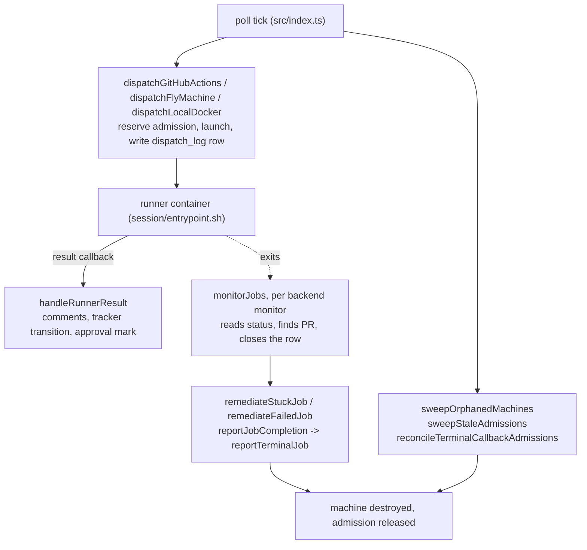

# Implementation lifecycle

How an implementation job runs today (Legacy), and the duty table that maps every Legacy function that finishes or fixes an implementation job to the step of the `ImplementationRun` workflow (`src/restate/implementation-run-workflow.ts`) that takes its work over. Step 2 of [AII-1550](https://linear.app/eudoxus/issue/AII-1550/run-implementation-jobs-as-a-restate-workflow).

**Status.** `ImplementationRun` exists in the tree ([AII-1553](https://linear.app/eudoxus/issue/AII-1553)); no production path starts it yet ([AII-1557](https://linear.app/eudoxus/issue/AII-1557) wires it). The step names below are the real ones, the `PlanningRun` names (`src/restate/planning-run-workflow.ts`) plus nothing new: `reserve`, `dispatch`, `wait`, `stop`, `finish-job`, `cleanup`, `outcome`, `release`. Keep a step name stable: the Restate UI, the job drawer and the tests read it. Every function, file, and rule named here exists in the tree; line numbers are not cited because they drift.

**Why the table exists.** Planning missed two duties the first time (AII-1018): the reaper's machine cleanup, and the notice and breaker bookkeeping in `reportJobCompletion`. Each Legacy function below *skips* a Restate-owned job (`isRestateOwnedJob`), so a duty with no workflow step is silently dropped for an owned job. The table is the check that none is. Planning's version of this table is in [restate.md](restate.md) § "Legacy functions that fence on `isRestateOwnedJob`".

## How an implementation job runs today

1. **Launch.** The poll loop admits the issue (`canDispatch`, then `acquireDispatch` with `lifecycleOwner: { kind: "legacy" }`), launches on GitHub Actions, Fly Machines, or local Docker, and appends a `dispatch_log` row (`dispatchGitHubActions`, `dispatchFlyMachine`, `dispatchLocalDocker` in `src/index.ts`). The launch move is step 1 of AII-1550 and is not in this table.
2. **Report.** The runner calls back once (`handleRunnerResult`, `src/runner-callback.ts`). For an implementation job the callback writes the tracker transition and, on success, the approval mark (`stampJobApproved`); **it does not close the job row** for a success or an ordinary failure (only the operator-cancel branch writes `failed` / `operator_cancelled`). The row is closed by the monitor.
3. **Monitor.** Each poll, `monitorJobs` runs the TTL check, then one monitor per backend (`monitorGitHubActionsJob`, `monitorFlyMachineJob`, `monitorLocalDockerJob`). A monitor reads the backend status, finds the PR, writes the terminal status with `backendTerminated: true` (which releases the admission), and applies the ticket transition or the bounded failure cleanup.
4. **Report completion.** `monitorJobs` ends with `reportJobCompletion`, which calls `reportTerminalJob` for each terminal job not yet notified: breaker count, failure comment, completion notice.
5. **Sweeps.** Three sweeps run each poll after the monitors, in this order: `sweepOrphanedMachines` (`src/reaper.ts`), `sweepStaleAdmissions`, `reconcileTerminalCallbackAdmissions` (`src/dispatch-admission.ts`). `drainCommentGapfillQueue` follows for PR comments. `startupReconciliation` does the machine pass once at boot.

**Dedup and the ticket.** Re-arming an issue means `clearWorkingState` on the ticket plus `deleteDispatched` (the dedup row has no TTL; it clears only when something removes it). `boundedCleanup` (`src/stuck-watchdog.ts`) does both for attempts 1-3 of a shared per-issue budget (`STUCK_JOB_MAX_ATTEMPTS = 3`, counter `incrementStuckAttempts`), and past the budget leaves dedup in place and fires `notifyStuckGiveUp` plus a tracker comment.

## The `isRestateOwnedJob` call sites

`isRestateOwnedJob` is defined three times (`src/index.ts`, `src/stuck-watchdog.ts`, `src/reaper.ts`); `src/report-card.ts` holds a fourth copy named `isRestateOwned` that only builds the Restate link for the job drawer and fences nothing. The definition reads the job's admission row and answers true when `lifecycleOwner.kind` is `restate`. `grep -n isRestateOwnedJob` finds the definition plus these **nine** call sites. (The issue text says seven for `src/index.ts`; the real count there is **six**, and the seventh `grep` hit is the definition.)

| # | File | Call site | Effect for an owned job | Duty rows |
|---|---|---|---|---|
| 1 | `src/index.ts` | `monitorJobs` (TTL branch) | skips the TTL finalize, falls through to the per-backend monitor | D1 |
| 2 | `src/index.ts` | `monitorGitHubActionsJob` | returns before any run lookup or status write | D2 to D8 |
| 3 | `src/index.ts` | `monitorFlyMachineJob` | returns before the timeout, status read, destroy | D9 to D16 |
| 4 | `src/index.ts` | `monitorLocalDockerJob` | returns before the timeout, status read, remove | D17 to D19 |
| 5 | `src/index.ts` | `reportJobCompletion` | skips `reportTerminalJob` | D27 to D33 |
| 6 | `src/index.ts` | `startupReconciliation` | skips the stale-terminal destroy | D24 |
| 7 | `src/stuck-watchdog.ts` | `remediateStuckJob` | returns `false`, does nothing | D20 |
| 8 | `src/stuck-watchdog.ts` | `remediateFailedJob` | returns, unless `opts.ownerCall` | D21 |
| 9 | `src/reaper.ts` | `sweepOrphanedMachines` | skips the `stale-terminal-job`, `max-age-exceeded`, `issue-terminal` rules | D22, D23 |

`sweepStaleAdmissions` and `reconcileTerminalCallbackAdmissions` do not call it: they select `lifecycle_owner = 'legacy'` rows in SQL (the second also checks `candidate.lifecycleOwner.kind !== "legacy"`), so an owned reservation never reaches them (D25, D26).

## The steps

| Step | What it does | Counterpart in `PlanningRun` |
|---|---|---|
| `reserve` | takes the admission row with `lifecycleOwner: { kind: "restate" }` | `reserve` |
| `dispatch` | `findExistingRun` first, then the launch on the selected backend (the launch move, AII-1550 step 1); returns ids only, never a token | `dispatch` |
| `wait` | `awaitOwnedRun`: waits for the runner `report`, a run-ended status read, or a deadline; the bounded status read is the `readStatus` of the wait | `wait`, `confirm` |
| `stop` | requests the backend stop and confirms termination | `stop` |
| `finish-job` | reads the `dispatch_log` row, writes the terminal status the callback did not (`backendTerminated` only when confirmed), and makes the ticket move through `finalizeImplementation`. At the deadline it is `finish-job-deadline` (the bounded stuck cleanup, `remediateStuckJob` with `ownerCall`); on the escape path `finish-job-escape` | `finish-job` |
| `cleanup` | best-effort backend cleanup: removes the attempt's Fly machine (`destroyMachineRecorded`) or local container, a 404 counts as done; GitHub Actions is a no-op. Session logs, status comments and nonce invalidation belong here too | `cleanup` |
| `outcome` | `reportTerminalJob` with `ownerCall: true`: breaker count, failure comment, completion notice | `outcome` |
| `release` | releases the admission after termination is confirmed | `release` |

There is no separate ticket step. The ticket transition is part of `finish-job`, through the shared finalizer `finalizeImplementation` (`src/implementation-finalize.ts`, AII-1556). `report` carries optional model usage but no job outcome, so the step reads the `dispatch_log` row (`approved`, `conclusion`, `failure_commented_at`, `pr_url`) to learn what the runner callback already did, and does only the rest (`finishImplementationJob`, `src/restate/implementation-run-finish.ts`; see D34 to D40). A callback that made the transition is never repeated, and `runner_approved` survives.

## Duty table

"Trigger" is the condition under which the Legacy code does the work. "Owner" is a workflow step, or **stays outside the workflow** with the reason. Shared helpers (`boundedCleanup`, `findPrForIssue`, `safeDestroyMachine`) are listed under the caller.

### Monitors and the TTL check

| ID | Legacy function | What it does for an implementation job | Trigger | Owner |
|---|---|---|---|---|
| D1 | `monitorJobs` (TTL check, `jobTtlDecision`, `ttlStopRunnerForJob`) | After `maxJobMinutes` (mapping, default 90): stops the runner, calls `remediateStuckJob(..., "ttl_expired")`, then re-asserts `timed_out` / `ttl_expired`. Skips a row whose fresh conclusion is `operator_cancelled`, `runner_approved`, or `external_review_pending` (`TTL_STALE_CONCLUSIONS`) | job in flight past the TTL; not `kg-refresh` | `wait` (total deadline) then `stop` and `finish-job`. The stale-conclusion guard becomes: a `report` that arrived first wins over the deadline |
| D2 | `monitorGitHubActionsJob` (run link) | Finds the run (`findWorkflowRunId`, `attachJobRunIdIfMissing`) so later polls can read it | GHA job with no `runId` | `dispatch` (the exact run identity is recorded at launch, so no heuristic link) |
| D3 | `monitorGitHubActionsJob` (`run_not_found`) | No run found within `RUN_ID_TIMEOUT_MS`: `remediateStuckJob(..., "run_not_found")` | GHA job still without a run id past the timeout | `wait` (bootstrap deadline) then `stop`, `finish-job`, `outcome` |
| D4 | `monitorGitHubActionsJob` (stuck watchdog) | Run not terminal past the workflow timeout plus grace (`githubActionsWatchdogDecision`): cancels the run, `remediateStuckJob` | `status` queued or in progress and overdue | `wait` (total deadline) then `stop`, `finish-job`, `outcome` |
| D5 | `monitorGitHubActionsJob` (completed run) | Maps `conclusion` to `completed` / `timed_out` / `failed`; looks up the PR (`findPrForRun`, then `findPrForIssue`); writes the terminal status with `backendTerminated: true`; also marks a `dispatched` row running (`updateJobRunId`) | run `status` is `completed`; running mark on a queued or in-progress run | `wait` (status read marks the row running) then `finish-job` |
| D6 | `monitorGitHubActionsJob` (already-merged PR), via `finalizeImplementation` (`src/implementation-finalize.ts`, AII-1556) | `reconcileAlreadyMergedPr`: enqueues the Done-reconcile (`enqueueReconciliation`), resets the stuck counter | the matched PR is already merged (auto-merge beat the monitor) | `finish-job` |
| D7 | `monitorGitHubActionsJob` (no-op grouping parent), via `finalizeImplementation` (`src/implementation-finalize.ts`, AII-1556) | `finalizeNoOpGroupingParent`: `markMerged`, `resetStuckAttempts` so merge-up can open the roll-up PR | clean run, no PR, `job.groupingParent` | `finish-job` |
| D8 | `monitorGitHubActionsJob` (failed run), via `finalizeImplementation` (`src/implementation-finalize.ts`, AII-1556) | `remediateFailedJob` | `jobStatus` is `failed` (a `timed_out` conclusion does not call it) | `finish-job` (the finalizer runs `remediateFailedJob` with `ownerCall`) |
| D9 | `monitorFlyMachineJob` (timeout) | Past `jobTimeoutMs`: `postSessionLogs("machine_timeout")`, a `timeout` status comment, destroys the machine (`destroyMachineRecorded`), `invalidateNonce`, `remediateStuckJob(..., "machine_timeout")`. Logs and comment are skipped for `runnerMode: "shadow"` | machine older than the job timeout | `wait` (total deadline) then `stop` (destroy, nonce), `cleanup` (logs, comment), `finish-job`, `outcome` |
| D10 | `monitorFlyMachineJob` (running mark) | Marks a `dispatched` row `running` | machine state `started` or `created` | `wait` (first started status read) |
| D11 | `monitorFlyMachineJob` (stopped machine, PR and outcome) | `findPrForIssue` (state `all`), reads the exit code, `decideCleanExitOutcome` (status, draft-PR and needs-attention handling, grouping-parent finalize flag) | machine `stopped` or `destroyed`, or a Fly 404 | `finish-job` |
| D12 | `monitorFlyMachineJob` / `monitorLocalDockerJob` (PR-recheck grace) | A clean exit with no PR is not `pr_not_found` for `PR_NOT_FOUND_GRACE_MS` (120 s); the monitor returns and re-checks next poll. The grace is an in-process `Map` (`noPrFirstSeenAt`, `src/monitor-status.ts`), cleared by `clearPrNotFoundGrace` | exit 0, no PR visible, child (not grouping parent) job | `wait` (a durable timer replaces the in-memory map; `finish-job` runs after the window) |
| D13 | `monitorFlyMachineJob` (logs and `pr_number` stamp) | `postSessionLogs("session_failed")` or `("post_push_review_not_approved")` before destroy; `updateMachineMetadata("pr_number")` | machine not already destroyed, job failed or review needs attention | `cleanup` |
| D14 | `monitorFlyMachineJob` (destroy stopped machine) | `destroyMachineRecorded("monitor-stopped")`, ignoring 404 | machine `stopped` | `cleanup` |
| D15 | `monitorFlyMachineJob` (close row) | `updateJobStatus(..., { backendTerminated: true })` (conclusion `no_op_finalized` for a grouping parent), `invalidateNonce`, `clearPrNotFoundGrace`; posts the `machine_destroyed` status comment (not for shadow jobs) | after the destroy attempt | `finish-job` (row, nonce), `cleanup` (comment) |
| D16 | `monitorFlyMachineJob` (ticket transition), via `finalizeImplementation` (`src/implementation-finalize.ts`, AII-1556) | merged PR: `reconcileAlreadyMergedPr`; `completed` or `review_failed` with a PR: `markReadyForReview` (`markPrReady`, `resetStuckAttempts`), **skipped for a draft PR** (unapproved run: the callback owns the transition); `failed`: `remediateFailedJob`; grouping parent: `finalizeNoOpGroupingParent` | after the row is closed | `finish-job` (merged, ready, draft no-op, finalize, and the failed case through the finalizer) |
| D17 | `monitorLocalDockerJob` (timeout) | As D9 with `postLocalContainerLogs("container_timeout")`, a `timeout` comment, `removeLocalContainer`, `remediateStuckJob(..., "container_timeout")`. No shadow check | container older than the job timeout | `wait` then `stop`, `cleanup`, `finish-job`, `outcome` |
| D18 | `monitorLocalDockerJob` (running mark, outcome, close) | `inspectLocalContainer`; running mark; `findPrForIssue` only on exit 0; `decideCleanExitOutcome`; logs (`pr_not_found`, `container_failed`, `post_push_review_not_approved`); `removeLocalContainer`; `updateJobStatus(..., { backendTerminated: true })` with conclusion `exit_<code>`; `machine_destroyed` comment | container stopped with an exit code | `wait` (running mark, PR-recheck), `finish-job`, `cleanup` |
| D19 | `monitorLocalDockerJob` (ticket transition), via `finalizeImplementation` (`src/implementation-finalize.ts`, AII-1556) | grouping-parent finalize, else merged PR reconcile, else `markReadyForReview` (not for a draft PR), else `remediateFailedJob` for every other case | after the row is closed | `finish-job` (all cases, through the finalizer) |

### Watchdog, sweeps, and boot

| ID | Legacy function | What it does for an implementation job | Trigger | Owner |
|---|---|---|---|---|
| D20 | `remediateStuckJob` (`src/stuck-watchdog.ts`) | Returns early for no `issueId`, `kg-refresh`, an owned job, or `operator_cancelled`. Stops the runner (caller `stopRunner`, or cancels the GHA run and reads its status). Runs `boundedCleanup`. Writes `timed_out` with `stuck_requeued` (attempts 1-3) or `stuck_giveup`, with `backendTerminated` only when the stop is confirmed, else `skipAdmissionRelease` | a monitor decided the job is stuck (D1, D3, D4, D9, D17) | `stop` (the stop and its confirmation), `finish-job` (`remediateStuckJob` with `ownerCall`: the row write and `boundedCleanup`: counter, ticket reset, give-up alert and comment). `opts.ownerCall: true` lifts the owned-job fence (as `remediateFailedJob` has); legacy callers never set it |
| D21 | `remediateFailedJob` (`src/stuck-watchdog.ts`) | `boundedCleanup` for a failed run whose runner already stopped: attempts 1-3 clear the working state and dedup, later attempts alert and comment. Fenced for an owned job unless `ownerCall: true` | failed job without a draft PR (D8, D16, D19, and the callback, D36) | `finish-job` (the finalizer calls it with `ownerCall: true`) |
| D22 | `sweepOrphanedMachines`: `stale-terminal-job` | Destroys the machine of a job whose row is already terminal | Fly machine tagged to this orchestrator, job row terminal | `cleanup` (planning's missed duty, AII-1018) |
| D23 | `sweepOrphanedMachines`: `max-age-exceeded`, `issue-terminal` | Rule `max-age-exceeded` (`SWEEP_MACHINE_MAX_AGE_MS`, 4 h): dumps session logs if no PR, destroys, writes `timed_out` / `machine_max_age_sweep`, `invalidateNonce`, `resetTicket`. Rule `issue-terminal`: the ticket reached `completed` or `cancelled` (`fetchLifecycleStates`): destroys, writes `issue_completed_sweep`, `resetTicket`. Both use `skipAdmissionRelease` when the destroy is unconfirmed | in-flight job past 4 h, or ticket closed outside the flow | `max-age-exceeded`: `wait` (total deadline) then `stop`, `cleanup` (logs), `finish-job` (the bounded stuck cleanup resets the ticket). `issue-terminal`: **not read by the workflow** (settled in AII-1553): an owned run whose ticket closes runs to its `report`, its end, or its deadline, and the reaper's 4 h `max-age-exceeded` rule stays the backstop |
| D23a | `sweepOrphanedMachines`: `orphan`, `durable-expired`, owner filter, burst alert | `orphan`: no job row, destroy. `durable-expired`: past `durable_until` on a `FlyMachineProfile` machine. Skips machines tagged to another orchestrator. Records `recordReaperAction`; alerts above `reaperAlertThreshold` (`notifyReaperBurst`) | every poll | **stays outside the workflow:** there is no job row (`orphan`) or no workflow (`durable-expired`) to own the machine, so this is the backstop that exists for a lost owner. The rules are not fenced by `isRestateOwnedJob` and need no change |
| D23b | `sweepExitedLocalContainers` (`src/local-docker.ts`, called from the poll loop) | Removes exited local containers that no in-flight job owns | `runnerMode` is `local` | **stays outside the workflow:** a backstop for a container `cleanup` missed; it keys on the in-flight machine ids and so needs no fence |
| D24 | `startupReconciliation` (`src/index.ts`) | At boot, lists machines: `orphan` (no job row) destroyed; durable-runner machine kept; an owned job skipped; a terminal job's machine destroyed (`startup-stale-terminal`) with nonce invalidation; an in-flight job's machine logged as resumed | orchestrator start | Orphan and durable rows **stay outside the workflow** (no owner). Stale-terminal for an owned job: `cleanup`; Restate replays an unfinished workflow after a restart, so boot recovery is not needed for it. A workflow that never replays is left to D22 |
| D25 | `sweepStaleAdmissions` (`src/dispatch-admission.ts`) | Releases a **legacy** reservation unreleased for `DEFAULT_ADMISSION_SWEEP_MAX_AGE_MS` (6 h) once `confirmAdmissionTerminated` proves the backend ended; reason `deadline_exceeded` | legacy reservation older than 6 h | `release` for an owned run (after `wait`'s confirmed-ended read). The sweep **stays outside the workflow** for legacy rows; its SQL excludes owned ones |
| D26 | `reconcileTerminalCallbackAdmissions` | Releases the reservation of a legacy job whose row is terminal but whose reservation is held (a callback or unconfirmed stop wrote the status), after the same backend oracle; reason `cancelled` for `operator_cancelled`, else `finalized` | each poll | `release` (after `stop` / `wait` confirm termination). **Stays outside the workflow** for legacy rows. The oracle `confirmAdmissionTerminated` is shared: both read the same backend classifiers as `wait`'s status read |

### Completion reporting

| ID | Legacy function | What it does for an implementation job | Trigger | Owner |
|---|---|---|---|---|
| D27 | `reportJobCompletion` | Loops `getUnnotifiedTerminalJobs`, skips owned jobs, calls `reportTerminalJob` | each poll, after the monitors | `outcome` (calls `reportTerminalJob` with `ownerCall: true`) |
| D28 | `reportTerminalJob`: breaker count | `recordDispatchSuccess` on `completed`; `recordDispatchFailure` on `failed` / `timed_out` / `review_failed` (skips `operator_cancelled`; skips a classified transient failure via `shouldCountFailure`). Breaker phase is `implementation` | terminal row, not yet notified | `outcome`. With `ownerCall` the count and `markJobNotified` run in one transaction, so a retry never counts twice |
| D29 | `reportTerminalJob`: breaker trip | `fireBreakerTrip` posts the park comment and notice when the count trips (not for `stuck_*`) | `recordDispatchFailure` returns `tripped` | `outcome` |
| D30 | `reportTerminalJob`: stuck suppression | `stuck_giveup` / `stuck_requeued` send no ordinary notice (`notifyStuckGiveUp` already fired, or the requeue is silent); marks notified | conclusion `stuck_*` | `outcome` |
| D31 | `reportTerminalJob`: operator-cancel notice | One informational `notifyText`, no failure comment, no breaker; marks notified | conclusion `operator_cancelled` | `outcome` |
| D32 | `reportTerminalJob`: tracker classification comment | `classifyCompletion` + `renderClassification` posted with `postComment`, only when the callback has not already commented (`shouldPostMonitorClassificationComment`, i.e. `failureCommentedAt` unset). Independent of the webhook | terminal failure with a provider | `outcome` |
| D33 | `reportTerminalJob`: completion notice | `notifyCompletion` to the webhook, then `markJobNotified` | `config.notifyWebhookUrl` set | `outcome` |

### Runner callback (`handleRunnerResult`, `src/runner-callback.ts`)

The callback is the runner's authenticated self-report: it checks the run token (consuming it only for Legacy runs) and holds the payload (comments, failure record, dispositions), so its tracker writes **stay outside the workflow**. What changes for an owned job is who closes the row and who runs the cleanup. `handleRunnerResult` is therefore an input to `wait` (the `report` signal), as in planning, where the callback sends `report` through a hook after it writes the row.

For an owned planning or implementation result, `callback_lifecycle_completed_at` records that callback lifecycle handling finished, before the workflow forward. Retries skip those effects even while the workflow has not closed the job row, and still forward sanitized usage on every request. A failed forward leaves both this marker and the check-only token available for the retry.

| ID | Branch | What it does for an implementation job | Trigger | Owner |
|---|---|---|---|---|
| D34 | Shared pre-branch work | Posts the runner's `comments`; posts the missing reference-repo warning; for `follow-up` dispositions marks the findings deferred (`markReviewFindingsDeferredByKeys`) and posts the deferred-findings comment | every accepted result | **Stays outside the workflow:** needs the payload and runs after authentication |
| D35 | `outcome: "failure"` with `OPERATOR_CANCELLED` | `clearWorkingState`; writes `failed` / `operator_cancelled` with `skipAdmissionRelease` (the self-report is not proof the backend exited) | the operator closed the PR mid-run | Tracker write and row write **stay in the callback** (payload and token). `report` then reaches `wait`; `stop` and `release` confirm termination; the notice is D31 in `outcome`; no breaker, no remediation |
| D36 | `outcome: "failure"`, other codes | `updateJobFailure`; `markImplementationFailed` (failure comment, then `markJobFailureCommented`); `updateJobPrUrl` for a coded draft-PR failure (`REVIEW_UNAPPROVED`, `MAX_TURNS_EXHAUSTED`); `remediateFailedJob` **only when the body has no `prUrl`** | failure that is not `OPERATOR_CANCELLED` | Comment and failure record **stay in the callback**. The `remediateFailedJob` call is a no-op for an owned job (the fence), so `finish-job` runs it through the finalizer (with `ownerCall: true`) when the job has no PR. Row close: `finish-job` |
| D37 | `outcome: "failure"` with `GIT_LEASE_REJECTED` and a `prUrl` | `handleLeaseRejectedFailure`: bot-authored head: re-enqueue the review-fix (`acceptReviewFixWebhookEvent`); human head or unknown: sticky comment, no retry | lease rejected on an existing PR | **Stays outside the workflow:** it hands the work to the review-fix rail, not the implementation job |
| D38 | `outcome: "failure"` with `externalReviewPending` | `recordPendingLateReview` then `submitLateExternalReview` (workflow `LateExternalReview`), cleared when settled; otherwise the poll sweep retries | internal review approved, external review still running (AII-1227, AII-1362) | **Stays outside the workflow:** `LateExternalReview` is already its own workflow; a late approval mark is its duty, not `ImplementationRun`'s |
| D39 | `outcome: "success"` with `noWork` | `markMerged` (clears the working label so merge-up can open the roll-up PR) | grouping parent with no changes | **Stays in the callback** (it has the payload); `finish-job` does the same via D7 when no callback arrived |
| D40 | `outcome: "success"` with a PR | `markPrReady`; `stampJobApproved` sets `approved` and conclusion `runner_approved` atomically so the auto-merge gate reads it before the row closes. A missing `prUrl` (without `noWork`) is rejected 400 `missing_prUrl` | approved run | **Stays in the callback.** `finish-job` must preserve `runner_approved` (as `updateJobStatus` already does) and `finish-job` skips `markReadyForReview` when the callback made the transition |

### Gap-fill launch

| ID | Legacy function | What it does | Trigger | Owner |
|---|---|---|---|---|
| D41 | `drainCommentGapfillQueue` (`src/comment-gapfill-drain.ts`) | Launches a gap-fill run for a `/ai-implement` PR comment. Own admission: `canDispatch` with `kind: "gap-fill"` and a **PR scope** (one run per PR, `prDispatchBudget`), then `acquireGapfillAdmission` with `lifecycleOwner: { kind: "legacy" }`; defers or parks (`firePrBudgetPark`) when refused | pending row in the comment gap-fill queue | **Stays outside the workflow, on the legacy path, until [AII-1554](https://linear.app/eudoxus/issue/AII-1554) sends gap-fill runs and the feature-branch re-queue through `ImplementationRun`.** Until then its terminal handling is the legacy monitors' (`updateJobStatus` also terminalizes the queue row, `markCommentGapfillRunTerminal`) |

## Decisions from AII-1553

Settled 2026-10-26; the table above already uses them.

1. **Step names.** The real names are `reserve`, `dispatch`, `wait`, `stop`, `finish-job`, `cleanup`, `outcome`, `release`. There is no `ticket` step (the ticket move is part of `finish-job`, through `finalizeImplementation`), and `launch` is `dispatch`.
2. `remediateStuckJob` takes `ownerCall` (D20, added by AII-1556); the `finishJob` dep passes `ownerCall: true`.
3. **No ticket-lifecycle read in `wait`** (D23 `issue-terminal`). An owned run whose ticket closes runs to its `report`, its end, or its deadline; the reaper's 4 h `max-age-exceeded` rule stays the backstop.
4. **`finish-job` learns what the callback did from `dispatch_log`** (`approved`, `conclusion`, `failure_commented_at`, `failure`, `pr_url`), because `report` carries optional model usage but no job outcome (D16, D19, D40).
5. **The `running` mark** (D5, D10, D18) is written by the `readStatus` dep of the wait, as the monitors write it today. The write is idempotent.
6. `reconcileFilesystemFailures` (`src/filesystem-ticket-lifecycle.ts`) runs from `monitorJobs` but concerns filesystem-ticket mappings, not a job's backend; it is outside this table.

## Checks

- `grep -n isRestateOwnedJob src/index.ts src/stuck-watchdog.ts src/reaper.ts` shows one definition and the call sites in the table above (six, two, one).
- Every function named in a row exists in the file named in its heading; run `grep -rn "<name>" src` for each before changing a row.
- No file under `src/` changes with this doc.
