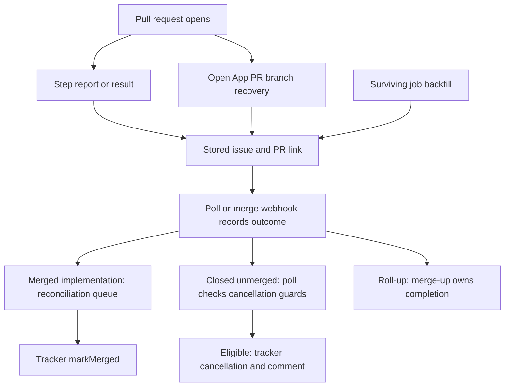

# Pull request links

`src/pr-links.ts` stores issue identity separately from execution history. Open pull request status and merge reconciliation therefore keep their issue mapping after `dispatch_log` rows are pruned. The tables initialize on first use through the shared database in `src/dedup.ts`.

The storage decision is recorded in [ADR 051](adr/051-a-pull-request-link-is-a-stored-row-written-when-the-pull-request-opens.md).

## Stored rows

All timestamps are integer Unix milliseconds. Nullable columns are marked below.

### `tracked_issue`

| Column | Meaning |
|---|---|
| `id` | Autoincrement integer primary key |
| `tracker_kind` | `linear`, `jira`, or `filesystem` |
| `mapping_key` | Owning configuration mapping key |
| `tracker_issue_id` | Provider's issue ID |
| `identifier` | Nullable human-readable issue key |
| `title` | Nullable last supplied title |
| `url` | Nullable tracker URL |
| `first_seen_at` | Time first stored |
| `updated_at` | Time metadata was last supplied |

The unique key is (`tracker_kind`, `tracker_issue_id`). Metadata refreshes replace identifier, title and URL, preserving mapping ownership and first-seen time.

### `pull_request_link`

| Column | Meaning |
|---|---|
| `id` | Autoincrement integer primary key |
| `repository` | GitHub `owner/repo` |
| `number` | Integer PR number |
| `url` | GitHub PR URL |
| `head_ref` | Nullable source branch |
| `base_ref` | Nullable target branch |
| `issue_id` | Foreign key to `tracked_issue.id` |
| `role` | `implementation` or `roll-up` |
| `outcome` | `open` (default), `merged`, or `closed-unmerged` |
| `source` | `step-report`, `result`, `branch-match`, or `backfill` |
| `linked_at` | Time first linked |
| `closed_at` | Nullable time terminal outcome was recorded |
| `cancel_checked_at` | Nullable time cancellation decision completed |

The unique key is (`repository`, `number`). `linkPullRequest` writes both rows transactionally. An existing PR keeps its original issue, role, source, URL and linked time; subsequent writes only fill missing branch refs. A conflicting issue association logs a warning. Existing databases gain `cancel_checked_at` on initialization.

## Writers and recovery

| Source | Writer and conditions |
|---|---|
| `step-report` | `src/session-api.ts` accepts an authenticated `push` step report with `outputs.prUrl`, then calls `linkJobPullRequest` in `src/log.ts`. This can preserve the association before a final result arrives. |
| `result` | `updateJobStatus`, `stampJobApproved` and `updateJobPrUrl` in `src/log.ts` call `linkJobPullRequest` when supplied a PR URL. Both job-based sources require a surviving job and configured mapping, write implementation links, and log link-write failures without failing the job update. |
| `branch-match` | `sweepUnlinkedPulls` in `src/pr-link-sweep.ts`, called each poll from `src/index.ts`, recovers open PRs authored by the configured App bot. |
| `backfill` | `backfillLinksFromJobRows` in `src/pr-links.ts` runs on first database initialization and can be called explicitly. It reads surviving `dispatch_log` rows with PR URLs, oldest dispatch/id first, and writes implementation links only when no link exists. Invalid GitHub URLs and absent mappings are skipped; tracker kind falls back to the mapping when absent from the row. |

Branch recovery recognizes `ai-implement/<KEY-number>-<suffix>` as implementation and `ai-implement/feature/<key>` or `ai-implement/multi-issue/<key>` as roll-up. It selects the sole repository mapping, or matches the key prefix to a mapping key when several share the repository, then resolves the uppercased identifier through the tracker. It requires a known App login and a resolvable issue; arbitrary branches are not recovered. Confirmed tracker misses are remembered in memory; tracker errors retry next poll. Repository and individual PR faults are isolated so the sweep continues.

Backfill cannot recover already-pruned jobs or closed PRs with no surviving job row. The open-PR sweep covers late publication after watchdog termination when the branch and tracker lookup meet its conditions.

## Readers and outcomes

- `src/open-pulls.ts`: `listOpenPulls` uses `findLinkByPr` for `tracked`, issue metadata, mapping ownership and `pr.role`. Job history supplies optional `lastJob` only. A stored link with a null identifier can still be tracked while returning `issue: null`. See [Spotter status tools](spotter-status-tools.md) for the response contract and five-minute fallback rules for both status tools.
- `src/poll-merged-prs.ts`: `detectMergedPrs` walks `listLinksByOutcome("open")`, independent of job retention, and checks GitHub for terminal PRs. Missing mappings and unreadable PR states leave links open for retry.
- `src/webhook.ts`: the merged-PR webhook reads `findLinkByPr`; an unknown PR is ignored. Both merge detectors use the stored issue identity for reconciliation.
- `src/reconcile-merged.ts`: `resolvePrMapping` uses the link's mapping key to disambiguate mappings sharing a repository. Without a link it resolves only a sole repository mapping. `runReconciliations` drains the queue through the provider's `markMerged`, including paused projects, with bounded failure retries. Roll-up completion belongs to `src/merge-up.ts`.

| Outcome | Who writes it |
|---|---|
| `open` | Default on insertion. The open-PR sweep also resets a previously terminal link when GitHub lists that PR open again. |
| `merged` | Merge poll or merged-PR webhook, through `setLinkOutcome`. Implementation links queue reconciliation unless already recorded; roll-up links only record the outcome here. |
| `closed-unmerged` | Merge poll, through `setLinkOutcome`. Implementation closes record reconciliation tombstones; cancellation decisions run separately so tombstones do not suppress retries. |

`setLinkOutcome` records the supplied close time for terminal outcomes. Reopening clears both `closed_at` and `cancel_checked_at`, allowing a later close to be considered again.

## Cancellation after an unmerged close

After outcome detection, `detectMergedPrs` walks `listUncheckedClosedLinks`. Cancellation applies to implementation links only, when there is no other open link for the same tracker issue and no run in flight. Roll-ups are exempt. A durable link identifying the issue's latest PR as a grouping-parent PR is also exempt: its existing finalization path calls `markMerged` before tombstoning, deferring while a run is in flight or finalization fails.

Exempt links and links superseded by another open PR get `cancel_checked_at` immediately. An in-flight run defers the decision without setting it. Otherwise `src/index.ts` resolves the stored mapping and calls the provider's `markPrClosedUnmerged`. On a nonthrowing return (including a provider no-op), the poll removes the issue's `dispatched` dedup row and calls `setCancelCheckedAt`. Missing mappings and provider errors leave the decision unchecked for retry.

| Provider implementation | Cancellation write |
|---|---|
| `src/providers/linear.ts` | Moves a nonterminal issue to Canceled, removes Ready for Review, and posts a comment naming the PR and how to restart. Missing or terminal issues are no-ops. |
| `src/providers/jira.ts` | Sets the AI-Implement status to `Implementation Failed` and posts the cancellation/restart comment. Native terminal issues and issues already marked Merged are no-ops. |
| `src/providers/filesystem.ts` | Sets an active task to `cancelled` and appends the cancellation/restart comment. Completed or cancelled tasks are no-ops. |

A cancelled child is terminal, so its parent's closing run can proceed without that child's work; see [feature-branch grouping](feature-branch-grouping.md).

## Retention

Nothing automatically prunes either table: job-history retention and reconciliation tombstones do not delete these rows. `deleteLinksForMapping` is an explicit deletion API that removes a mapping's links first and then its tracked issues. Retention therefore does not mean the rows are immutable or impossible to delete.

Grouping ownership is retained on each PR link with an additive `grouping_parent`
flag. Job writers and surviving-history backfill enrich it without clearing a
previous grouping flag on later gap-fill reports. `job_dispatched_at` and `job_id`
retain the newest dispatch ordering for each implementation link. `job_current`
marks the latest PR association reported by that job, so replacement URLs do not
tie with obsolete links. These columns are added on initialization; surviving
job history resolves replacements during backfill. Finalization
and cancellation use that ordering to identify the current PR after job pruning.
Backfill enriches existing links only for the same tracker issue, preserving their
metadata and role. Already-pruned grouping history cannot be reconstructed.

A confirmed implementation merge atomically promotes a skipped reconciliation
tombstone to pending in the same queue row, updating the merge SHA and resetting
attempts. This handles a closed PR that reopens and later merges through either
polling or webhook delivery. Pending, dispatched and failed rows remain deduplicated;
roll-ups remain excluded.
